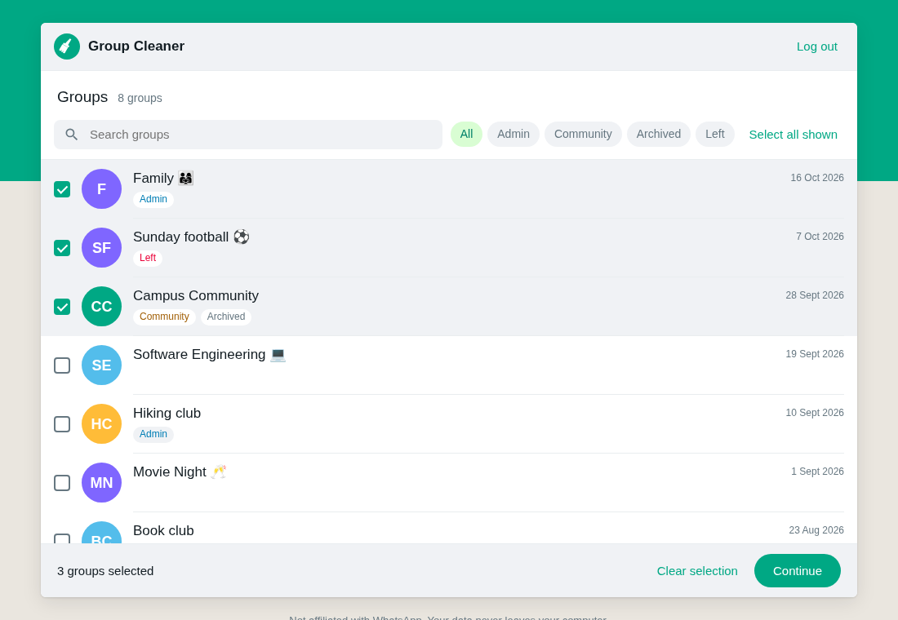
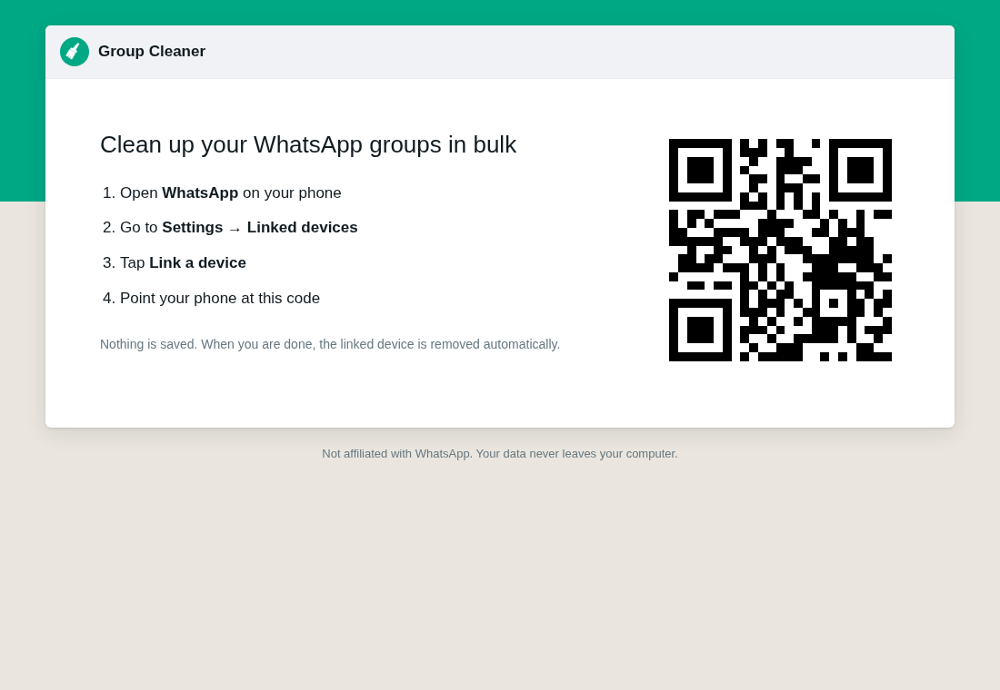
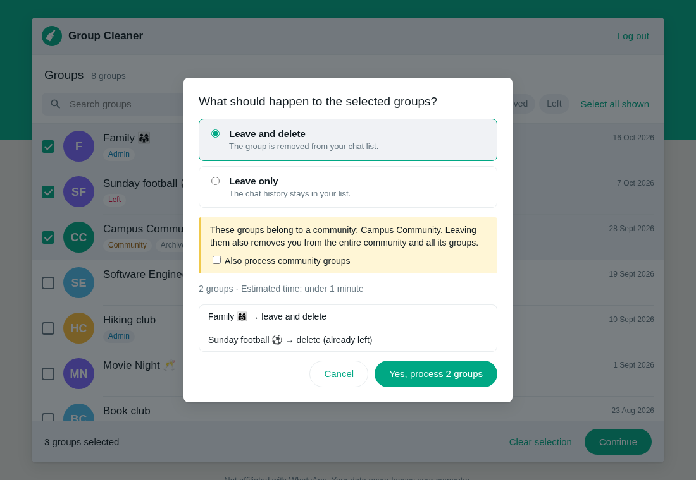
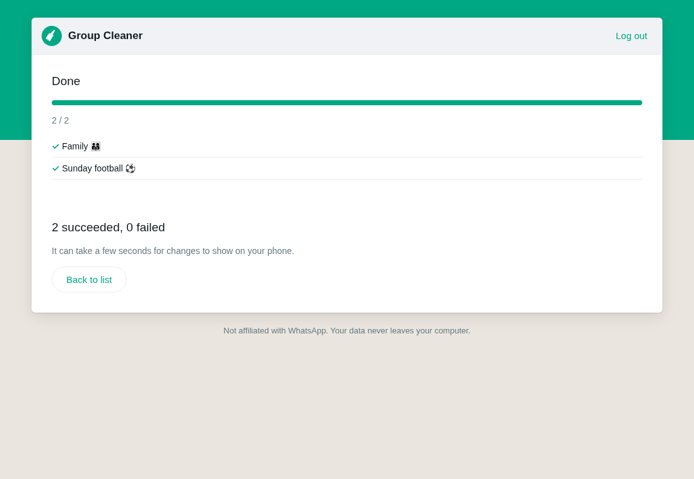

# WhatsApp Group Cleaner

[English](README.md) | **Türkçe**

Çok sayıda WhatsApp grubundan tek seferde çık ve onları sil. Grupları bilgisayarındaki basit bir web sayfasından seç, onayla, gerisini uygulama yapsın.



> [!WARNING]
> Bu uygulamanın **WhatsApp ya da Meta ile hiçbir resmî bağlantısı yoktur**. Uygulama WhatsApp Web'i otomatik olarak kullanır, bu da [WhatsApp Hizmet Koşulları](https://www.whatsapp.com/legal/terms-of-service)'na aykırıdır. Risk düşüktür ama sıfır değildir: WhatsApp otomasyon olarak gördüğü hesapları kısıtlayabilir. Uygulama bu riski azaltmak için işlemler arasında bekler. Kullanım sorumluluğu sana aittir. Uygulamayı sadece kendi hesabında kullan.

> Arayüz İngilizcedir. Bu belgede düğme ve ekran adları arayüzde göründükleri gibi İngilizce yazılmıştır.

## İçindekiler

- [Ne yapar](#ne-yapar)
- [Gereksinimler](#gereksinimler)
- [Kurulum](#kurulum)
- [Adım adım kullanım](#adım-adım-kullanım)
- [Nasıl çalışır](#nasıl-çalışır)
- [Gizlilik ve güvenlik](#gizlilik-ve-güvenlik)
- [Terminal sürümü](#terminal-sürümü)
- [Sorun giderme](#sorun-giderme)
- [Geliştirme](#geliştirme)
- [Lisans](#lisans)

## Ne yapar

- Bütün gruplarını fotoğrafları, son mesaj tarihleri ve etiketleriyle gösterir.
- Ada göre arama ve etikete göre filtreleme yapabilirsin.
- Seçtiğin her grup için iki işlemden birini yapar:
  - **Leave and delete** (çık ve sil): Gruptan çıkarsın ve sohbet listenden kalkar.
  - **Leave only** (sadece çık): Gruptan çıkarsın, sohbet geçmişi listende kalır.
- Hiçbir işlem yapmadan önce planı ve tahmini süreyi gösterir.
- Canlı ilerleme ve sonunda bir özet gösterir, örneğin `18 succeeded, 2 failed (Grup A, Grup B)`.

### Etiketler

| Etiket | Anlamı |
|---|---|
| **Admin** | Bu grupta yöneticisin. Tek yönetici sensen, sen çıkınca WhatsApp rastgele bir üyeyi yönetici yapar. |
| **Community** | Grup bir WhatsApp Topluluğuna bağlı. Bu gruptan çıkarsan topluluğun tamamından çıkarsın. Uygulama bu gruplara dokunmadan önce ayrıca sorar. |
| **Archived** | Sohbet arşivde. |
| **Left** | Bu gruptan zaten çıkmışsın. "Leave and delete" seçilirse sadece silinir. "Leave only" seçilirse atlanır. |

## Gereksinimler

- **Node.js 20 ya da daha yeni bir sürüm.** `node -v` ile kontrol et.
- **Google Chrome ya da Chromium.** Linux'ta `/usr/bin/google-chrome` varsa o kullanılır. Diğer sistemlerde `npm install`'ın indirdiği Chrome kullanılır.
- **Telefonunda WhatsApp** ve internet bağlantısı.
- macOS, Linux ya da Windows.

## Kurulum

```bash
git clone https://github.com/anilsrml/whatsapp-group-cleaner.git
cd whatsapp-group-cleaner
npm install
```

## Adım adım kullanım

Bütün süreç yaklaşık 5 dakika sürer. Buna her grup için yaklaşık 10 saniye eklenir.

### 1. Uygulamayı başlat

```bash
npm run ui
```

Tarayıcın uygulamayı açar. Açmazsa terminalde görünen adresi (`http://127.0.0.1:4747/#...`) kopyalayıp tarayıcına yapıştır. Uygulamayı kullanırken terminali açık tut.

### 2. Telefonunu bağla



1. Telefonunda WhatsApp'ı aç.
2. **Ayarlar** → **Bağlı cihazlar** → **Cihaz bağla**'ya git.
3. Ekrandaki QR kodu okut.

Ardından WhatsApp sohbetlerini yükler. Bu 1–2 dakika sürer.

### 3. Grupları seç

- Bir gruba tıklayınca seçilir. Tekrar tıklayınca seçim kalkar.
- **Search groups** kutusuna yazarak gruplarda ada göre ara.
- Bir etikete (**Admin**, **Community**, **Archived**, **Left**) tıklayınca sadece o gruplar görünür.
- **Select all shown** ekranda görünen bütün grupları seçer.

Hazır olunca **Continue**'ya tıkla.

### 4. Planı kontrol et ve onayla



1. **Leave and delete** ya da **Leave only** seç.
2. Topluluk grubu seçtiysen sarı bir kutu çıkar. **Also process community groups** kutusunu işaretlemezsen bu gruplar atlanır.
3. İşlem listesini ve tahmini süreyi kontrol et.
4. **Yes, process N groups**'a tıkla. Burada durmak istersen **Cancel**'a tıkla.

### 5. Sonucu bekle



Sekmeyi açık tut. Uygulama gruplar arasında 4–8 saniye bekler ve her 20 grupta bir 1 dakika mola verir. 100 grup yaklaşık 30 dakika sürer.

Bir grupta işlem başarısız olursa uygulama o grubu atlar ve devam eder. Özette başarısız olan gruplar listelenir. Onları tekrar seçip yeniden deneyebilirsin.

Başka gruplar işlemek için **Back to list**'e tıkla.

### 6. Çıkış yap

Sağ üst köşedeki **Log out**'a tıkla. Uygulama değişikliklerin telefonuna ulaşması için 10 saniye bekler. Sonra bağlı cihazı telefonundan kaldırır ve kapanır.

Terminalde **Ctrl+C**'ye de basabilirsin. Bu da bağlı cihazı kaldırır.

Emin olmak için telefonunda **Bağlı cihazlar**'ı aç. Uygulamanın cihazı ("Google Chrome") listede olmamalı.

## Nasıl çalışır

```
┌──────────────┐   HTTP (sadece 127.0.0.1)  ┌──────────────┐  Puppeteer  ┌────────────────────┐
│  Tarayıcın   │ ─────────────────────────▶ │ Yerel sunucu │ ──────────▶ │ Görünmez Chrome +  │ ──▶ WhatsApp
│ (uygulama)   │ ◀───────────────────────── │  (Node.js)   │ ◀────────── │   WhatsApp Web     │
└──────────────┘   0,7 sn'de bir durum      └──────────────┘             └────────────────────┘
```

1. `npm run ui` bilgisayarında küçük bir web sunucusu başlatır. Sunucu sadece senin bilgisayarından (`127.0.0.1`) gelen bağlantıları kabul eder.
2. Sunucu, WhatsApp Web'i açan görünmez bir Chrome penceresi başlatır. Bunun için [whatsapp-web.js](https://github.com/pedroslopez/whatsapp-web.js) ve Puppeteer kullanılır.
3. QR kodu okuttuğunda telefonun bu görünmez WhatsApp Web'i diğer bağlı cihazlar gibi bağlar.
4. Uygulama gruplarını doğrudan WhatsApp Web'den, tek tek okur. Bir grup okunamazsa diğerleri yine yüklenir.
5. **Leave and delete** için uygulama gruptan çıkar, WhatsApp artık üye olmadığını onaylayana kadar bekler ve ancak ondan sonra sohbeti siler. Sohbeti hemen silseydi, WhatsApp'tan gelen "Gruptan çıktın" mesajı sohbeti listene geri eklerdi.
6. Çıkış yaptığında uygulama WhatsApp Web'den çıkar. Bu, bağlı cihazı telefonundan kaldırır. Sonra Chrome'u kapatır.

### Proje yapısı

| Dosya | Amacı |
|---|---|
| `src/ui.js` | Web arayüzünü başlatır: WhatsApp oturumu, yerel sunucu, tarayıcıyı açma. |
| `src/server.js` | Yerel HTTP sunucusu ve API. |
| `src/session.js` | Web arayüzü için WhatsApp oturumu. |
| `src/whatsapp.js` | WhatsApp Web'de grupları okur, gruptan çıkar, siler ve fotoğrafları yükler. |
| `src/core.js` | WhatsApp'a bağımlı olmayan çekirdek mantık: etiketler, plan, süre, özet. |
| `src/cli.js`, `src/cliFlow.js` | Terminal sürümü. |
| `public/` | Web sayfası (HTML, CSS, JavaScript). |
| `test/`, `e2e/` | Birim testleri ve tarayıcı testleri. |

## Gizlilik ve güvenlik

- **Hiçbir şey başka bir sunucuya gönderilmez.** Uygulama sadece WhatsApp ile, WhatsApp Web'in yaptığı şekilde konuşur.
- **Oturum kaydedilmez.** WhatsApp oturumu saklanmaz. Chrome geçici bir profil kullanır ve uygulama kapanınca bu profil silinir. Uygulamayı her başlattığında QR kodu yeniden okutursun.
- **Mesaj içeriği okunmaz ve saklanmaz.** Uygulama sadece grup adlarını, etiketleri, tarihleri ve fotoğrafları okur.
- **Uygulamayı sadece senin bilgisayarın kullanabilir.** Sunucu `127.0.0.1`'i dinler ve başka bir alan adıyla gelen istekleri reddeder.
- **Başka siteler uygulamayı kontrol edemez.** Her başlatmada yeni ve rastgele bir anahtar üretilir. Anahtar adreste `#` işaretinden sonra durur, bu yüzden tarayıcı onu hiçbir sunucuya göndermez. Uygulama bu anahtarı taşımayan her API isteğini reddeder. Böylece tarayıcında açık başka bir site arka planda işlem başlatamaz.

## Terminal sürümü

Terminali tercih ediyorsan:

```bash
npm run dry-run   # ne olacağını gösterir, hiçbir şeyi değiştirmez
npm start         # işlemi yapar
```

Grupları ok tuşları ve **Boşluk** ile seç, sonra **Enter**'a bas. Onaylamak için `yes` yaz.

## Sorun giderme

| Sorun | Çözüm |
|---|---|
| `Port 4747 is in use` | Uygulamanın başka bir kopyası çalışıyor. Onu kapat ya da başka bir port kullan: `PORT=4848 npm run ui` |
| Chrome bulunamıyor | Chrome'un yolunu ver: `CHROME_PATH=/chrome/yolu npm run ui` |
| Tarayıcı açılmıyor | Terminaldeki adresi kopyalayıp tarayıcına yapıştır. |
| Bazı grupların fotoğrafı yok | O grupların fotoğrafı yok ya da WhatsApp fotoğrafı göndermedi. Uygulama onun yerine baş harfleri gösterir. |
| Bir grup telefonda hâlâ görünüyor | Birkaç saniye bekle. Değişikliklerin telefona ulaşması zaman alabilir. |
| "Google Chrome" Bağlı cihazlar'da hâlâ duruyor | Telefonundan kaldır: **Bağlı cihazlar** → cihaza dokun → **Çıkış yap**. |

## Geliştirme

```bash
npm test      # birim testleri
npm run e2e   # gerçek, görünmez bir Chrome'da tarayıcı testleri
```

Testler sahte bir WhatsApp oturumu kullanır, bu yüzden telefon gerektirmez. Kod test-first (önce test) yöntemiyle yazıldı.

## Lisans

[MIT](LICENSE)
